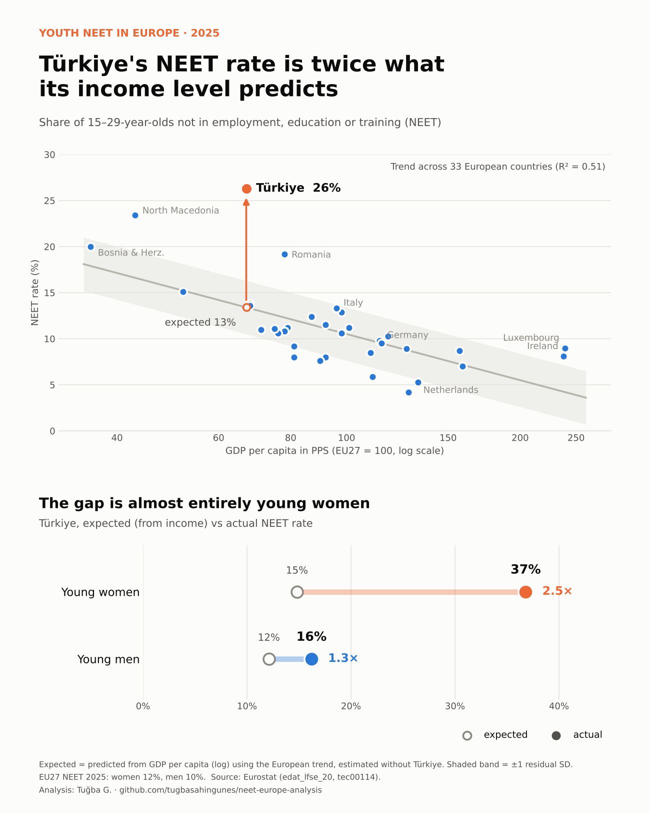

# Youth NEET in Europe: what the data says

Short, reproducible analyses of young people **not in employment, education or training (NEET)**
using open international data. Each folder is one analysis, with code, results and the figure
shared on LinkedIn.

Author: **Tuğba G.**, Family and Social Services Expert · Data & AI for Social Policy

---

## 01 · Country level: how much does income explain?
`01_country_level/` · Data: Eurostat, 2025 · Method: OLS regression



**Findings**
- Across 33 European countries, GDP per capita (PPS, log) explains about half of the variation in NEET rates among 15–29-year-olds (R² = 0.51).
- Based on its income level, Türkiye's expected NEET rate is about 13%; the actual rate is 26% (2025).
- The excess is concentrated among young women (37% actual vs 15% expected); for young men the gap is small (16% vs 12%).

**Robustness:** A multivariate model adding early school leaving and social protection spending was also estimated.
Türkiye is a highly influential observation (Cook's D = 1.37), and those additional effects are not robust to excluding it,
so only the income relationship is used for the headline. Full output: [`results/regression_results.md`](01_country_level/results/regression_results.md).

---

## 02 · Individual level: motherhood and the gender gap
`02_ess_microdata/` · Data: European Social Survey Round 11 (2023–24), 30 countries, n = 7,313 · Method: weighted logistic regression


**Findings**
- Young women are more often NEET than young men (15.7% vs 10.1%, weighted).
- Controlling for age, education, parental education, partner, migration background and country, the gap almost disappears for those **without** children at home (11% vs 10%).
- Young mothers have a predicted NEET probability of **51%**, young fathers 11%.
- Among NEET young mothers, 78% report housework or childcare as their main activity.

**Caveats:** cross-sectional data, so associations rather than causal effects. "Child at home" is derived from the household grid. The number of young fathers in the sample is small (n = 215).
Full output: [`results/regression_results.md`](02_ess_microdata/results/regression_results.md).

---

## Reproduce

```bash
pip install -r requirements.txt
python 01_country_level/analysis.py     # downloads Eurostat data if not cached
python 02_ess_microdata/analysis.py     # needs ESS11e04_2.csv in 02_ess_microdata/data/
```

## Data sources
- Eurostat: `edat_lfse_20`, `tec00114`, `edat_lfse_14`, `tps00098`, `educ_uoe_fine06`. Reuse permitted with attribution (© European Union).
- European Social Survey ERIC (2025). ESS Round 11 – integrated file, edition 4.2. Sikt. Not redistributed here.

Views are my own and do not represent any institution.
