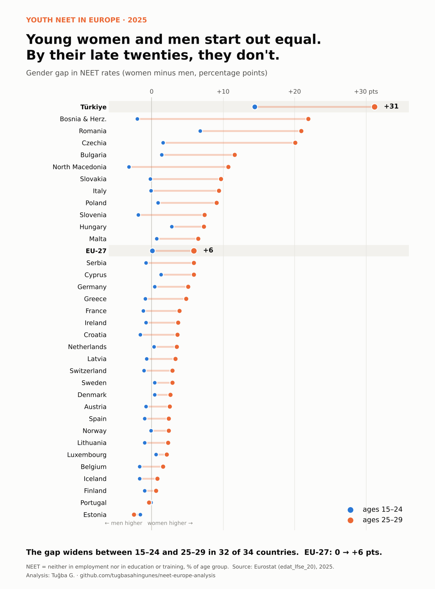
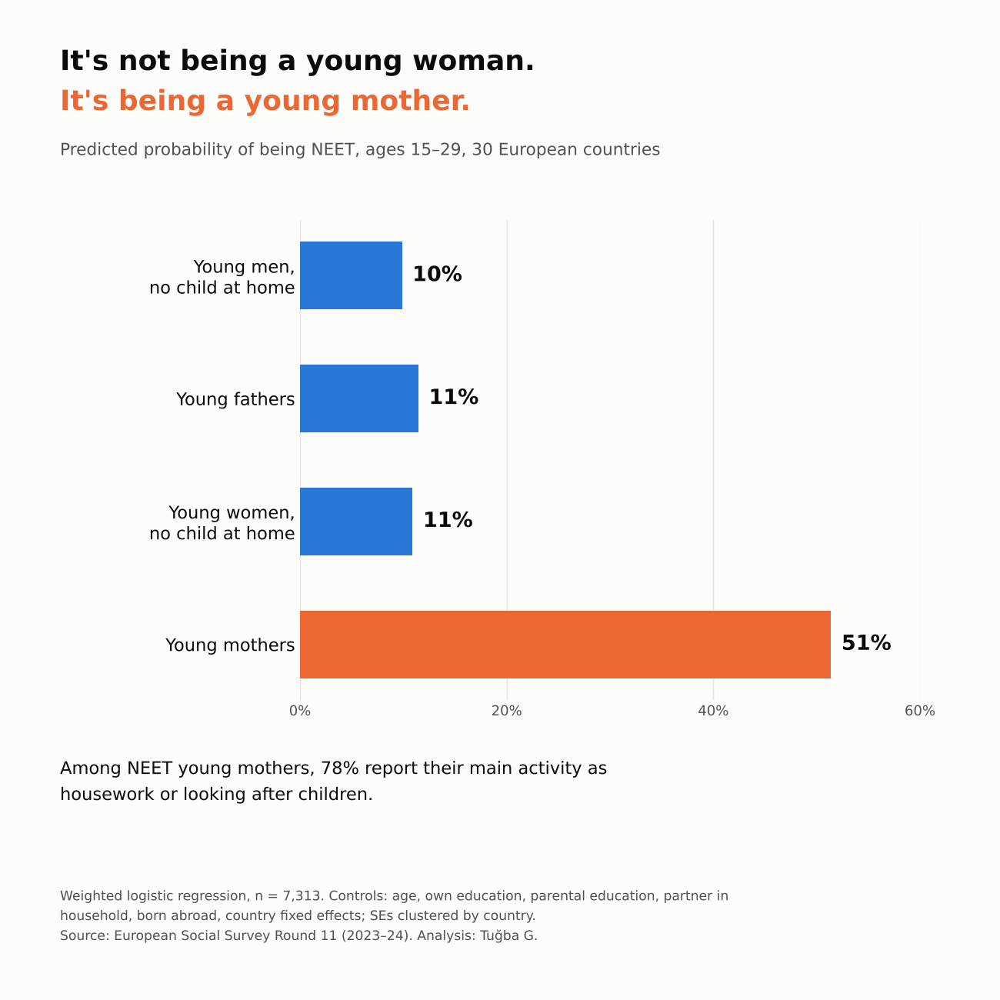
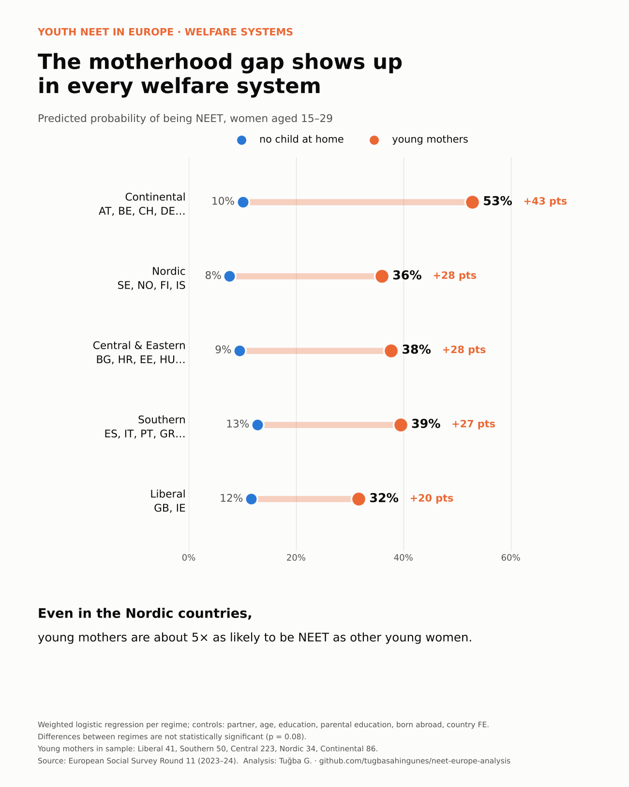
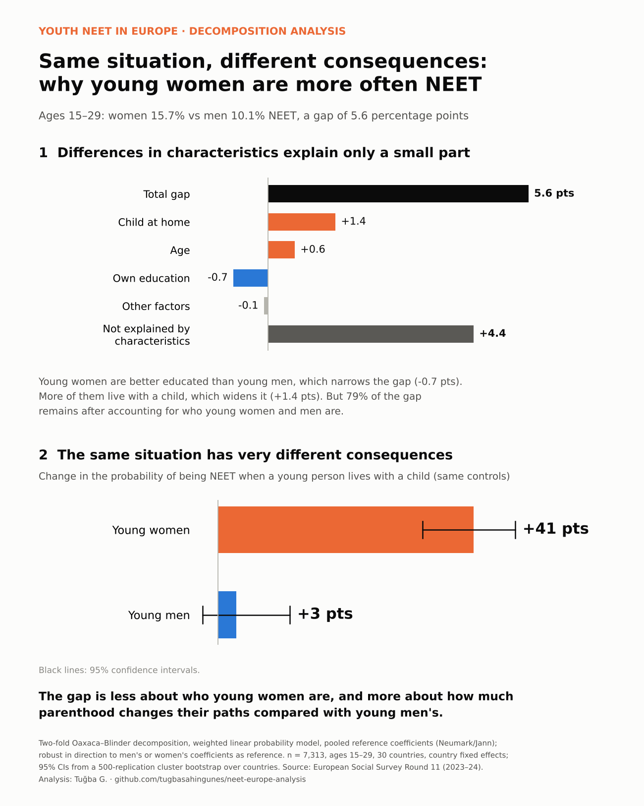
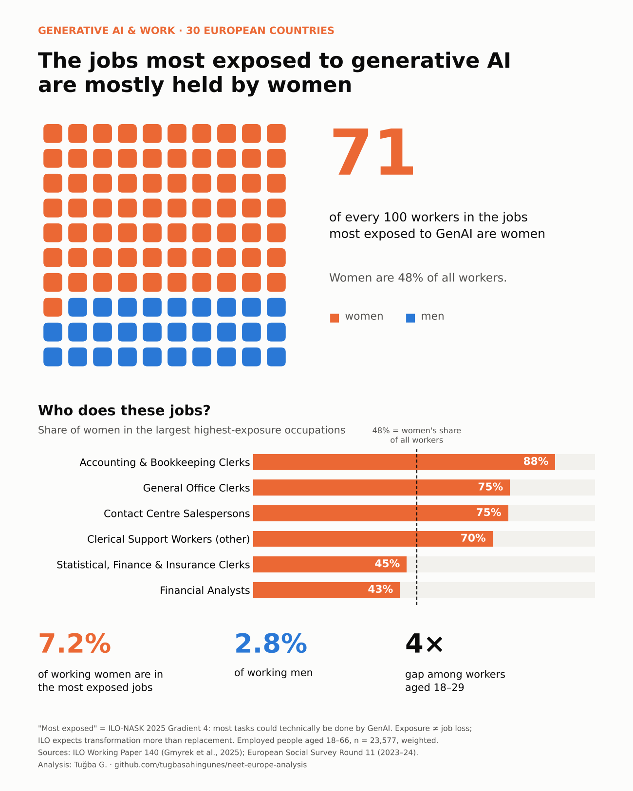
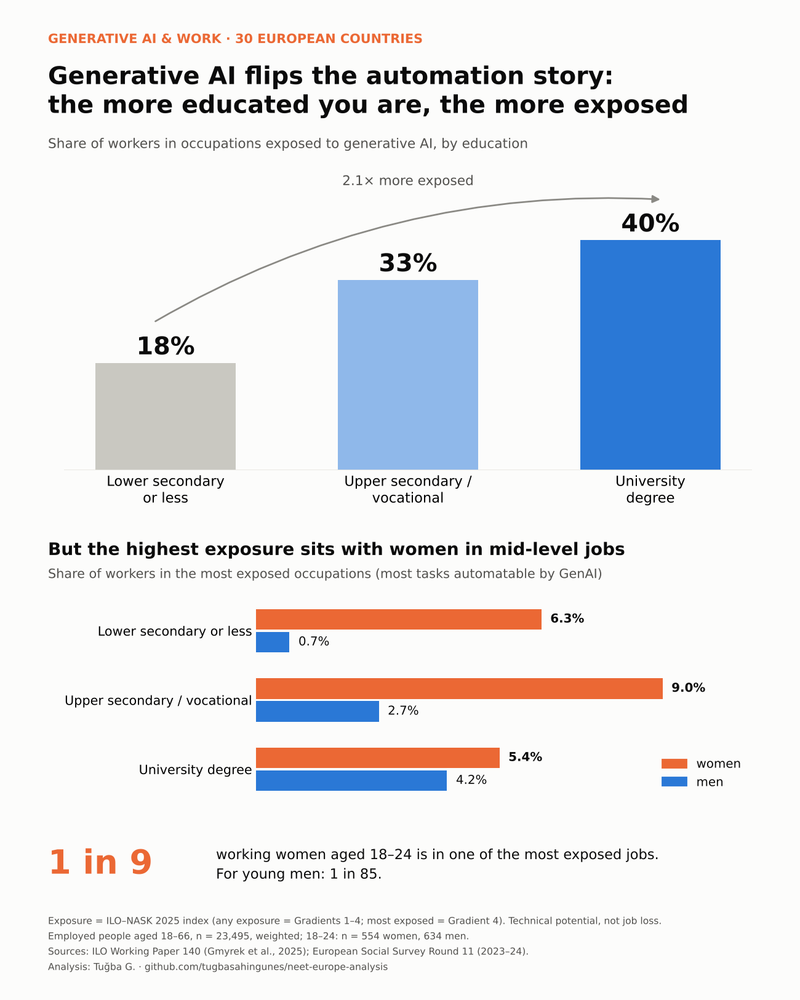
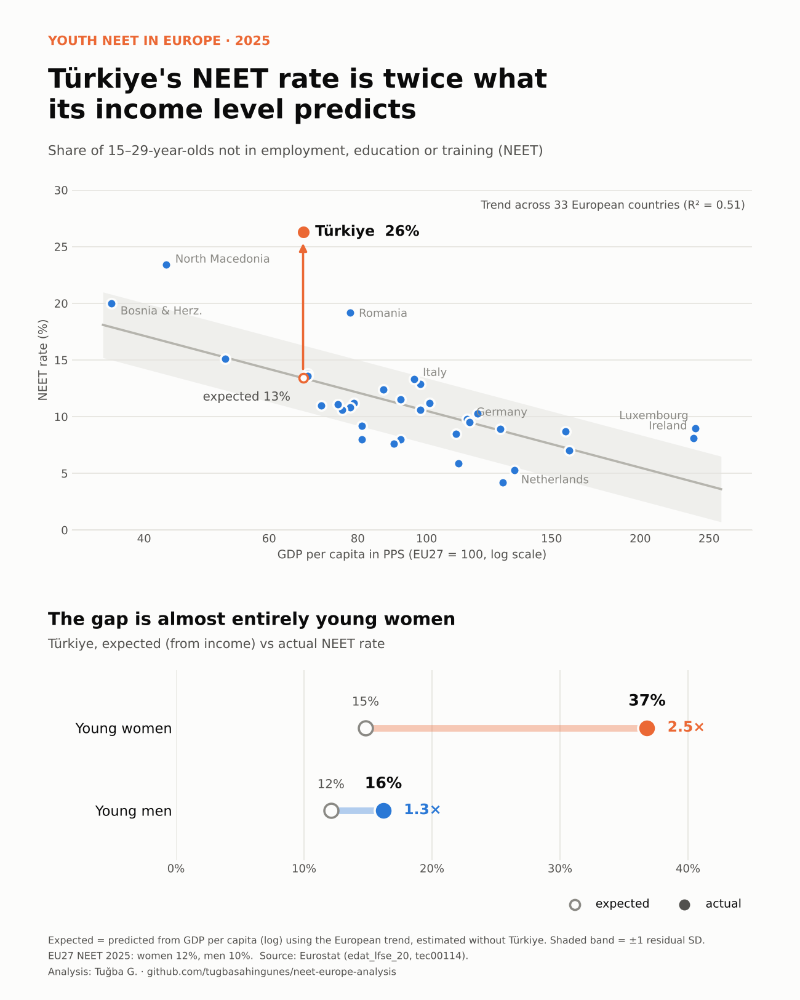

# Data & AI for social policy: Europe

Short, reproducible analyses of youth, gender, work and AI using open international data. Each folder is one analysis, with code, results and the figure
shared on LinkedIn.

Author: **Tuğba G.**, Family and Social Services Expert · Data & AI for Social Policy

---

## 01 · When does the gender gap open up?
`01_age_gender_gap/` · Data: Eurostat EU-LFS, 2025, 34 countries · Method: descriptive



**Findings**
- At ages 15–24, young women and men in the EU are equally likely to be NEET (9.1% vs 9.0%).
- At 25–29, a gap opens: 17.8% of women vs 11.9% of men.
- The gap widens with age in 32 of 34 countries.
- Türkiye has the largest gap: +14 points at 15–24 and +31 points at 25–29 (47% of women aged 25–29 are NEET).

Full table: [`results/summary.md`](01_age_gender_gap/results/summary.md). Methodology: [`METHODOLOGY.md`](01_age_gender_gap/METHODOLOGY.md).

---

## 02 · Individual level: motherhood and the gender gap
`02_ess_microdata/` · Data: European Social Survey Round 11 (2023–24), 30 countries, n = 7,313 · Method: weighted logistic regression



**Findings**
- Young women are more often NEET than young men (15.7% vs 10.1%, weighted).
- Controlling for age, education, parental education, partner, migration background and country, the gap almost disappears for those **without** children at home (11% vs 10%).
- Young mothers have a predicted NEET probability of **51%**, young fathers 11%.
- Among NEET young mothers, 78% report housework or childcare as their main activity.

**Caveats:** cross-sectional data, so associations rather than causal effects. "Child at home" is derived from the household grid. The number of young fathers in the sample is small (n = 215).
Full output: [`results/regression_results.md`](02_ess_microdata/results/regression_results.md). Methodology: [`METHODOLOGY.md`](02_ess_microdata/METHODOLOGY.md).

---

## 03 · Welfare regimes: does the motherhood gap differ?
`03_welfare_regimes/` · Data: ESS Round 11, women aged 15–29, 26 countries in five regimes · Method: logistic regression per regime + bootstrap



**Findings**
- The motherhood gap in NEET is large and positive in every welfare regime: from +20 points (Liberal) to +43 points (Continental).
- Even in the Nordic countries, young mothers are about 5× as likely to be NEET as other young women (36% vs 8%).
- Differences between regimes are **not** statistically significant (LR test, p = 0.08); small numbers of young mothers in some regimes make intervals wide.

Full output: [`results/results.md`](03_welfare_regimes/results/results.md). Methodology: [`METHODOLOGY.md`](03_welfare_regimes/METHODOLOGY.md).

---

## 07 · Decomposing the gender gap in youth NEET
`07_gender_gap_decomposition/` · Data: ESS Round 11, 7,313 young people, 30 countries · Method: Oaxaca–Blinder decomposition (pooled reference), cluster bootstrap over countries



**Findings**
- The NEET gap between young women and men is 5.6 points (15.7% vs 10.1%).
- Differences in characteristics explain only about a fifth of it. Young women's higher education *narrows* the gap; more of them living with a child *widens* it.
- Most of the gap comes from the same situation having different consequences: living with a child raises the NEET probability by 41 points for young women and by 3 points for young men.
- Robust in direction to the choice of reference coefficients.

Full output: [`results/results.md`](07_gender_gap_decomposition/results/results.md). Methodology: [`METHODOLOGY.md`](07_gender_gap_decomposition/METHODOLOGY.md).

---

## 05 · Generative AI exposure through a gender lens
`05_genai_exposure_gender/` · Data: ILO–NASK GenAI exposure index 2025 × ESS Round 11, 23,577 workers in 30 countries · Method: weighted descriptive



**Findings**
- Women are 71% of workers in the occupations most exposed to generative AI (ILO Gradient 4), vs 48% of all workers.
- 7.2% of working women vs 2.8% of working men are in these jobs; among 18–29-year-olds the gap is about 4×.
- The most exposed large occupations are clerical jobs held mostly by women.
- Exposure means technical potential, not job loss.

Full output: [`results/results.md`](05_genai_exposure_gender/results/results.md). Methodology: [`METHODOLOGY.md`](05_genai_exposure_gender/METHODOLOGY.md).

---

## 06 · Generative AI exposure by education and age
`06_genai_exposure_education_age/` · Data: ILO–NASK 2025 × ESS Round 11, 23,495 workers · Method: weighted descriptive + bootstrap



**Findings**
- Exposure rises with education: 18% of workers with lower secondary education or less are in exposed occupations, vs 40% of university graduates.
- The highest exposure is among women with upper secondary or vocational education (9.0% vs 2.7% of comparable men).
- Ages 18–24: about 1 in 9 working women vs 1 in 85 men are in the most exposed jobs (small sample; indicative).

Full output: [`results/results.md`](06_genai_exposure_education_age/results/results.md). Methodology: [`METHODOLOGY.md`](06_genai_exposure_education_age/METHODOLOGY.md).

---

## 04 · Appendix: how much does income explain?
`04_income_benchmark/` · Data: Eurostat, 2025 · Method: OLS regression



**Findings**
- Across 33 European countries, GDP per capita (PPS, log) explains about half of the variation in NEET rates among 15–29-year-olds (R² = 0.51).
- Based on its income level, Türkiye's expected NEET rate is about 13%; the actual rate is 26% (2025).
- The excess is concentrated among young women (37% actual vs 15% expected); for young men the gap is small (16% vs 12%).

**Robustness:** A multivariate model adding early school leaving and social protection spending was also estimated.
Türkiye is a highly influential observation (Cook's D = 1.37), and those additional effects are not robust to excluding it,
so only the income relationship is used for the headline. Full output: [`results/regression_results.md`](04_income_benchmark/results/regression_results.md). Methodology: [`METHODOLOGY.md`](04_income_benchmark/METHODOLOGY.md).

---

## Reproduce

```bash
pip install -r requirements.txt
python 01_age_gender_gap/analysis.py    # downloads Eurostat data if not cached
python 02_ess_microdata/analysis.py     # needs ESS11e04_2.csv in 02_ess_microdata/data/
python 03_welfare_regimes/analysis.py   # uses the same ESS file
python 04_income_benchmark/analysis.py
python 05_genai_exposure_gender/analysis.py
python 06_genai_exposure_education_age/analysis.py
python 07_gender_gap_decomposition/analysis.py
```

## Data sources
- Eurostat (2025 release): `edat_lfse_20`, `tec00114`, `edat_lfse_14`, `tps00098`, `educ_uoe_fine06`. Reuse permitted with attribution (© European Union).
- ILO–NASK (2025). Generative AI and Jobs: A Refined Global Index of Occupational Exposure. ILO Working Paper 140. CC BY 4.0.
- European Social Survey ERIC (2025). ESS Round 11 – integrated file, edition 4.2. Sikt. Not redistributed here.

Views are my own and do not represent any institution.
